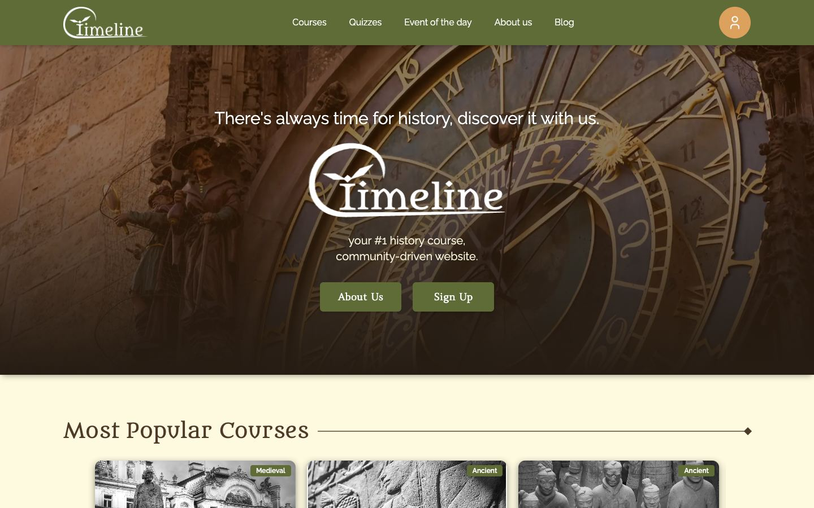
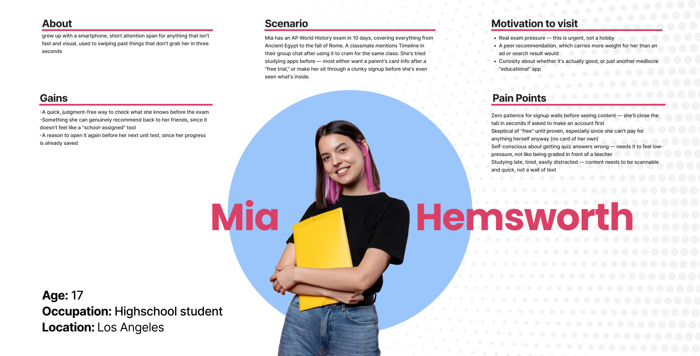
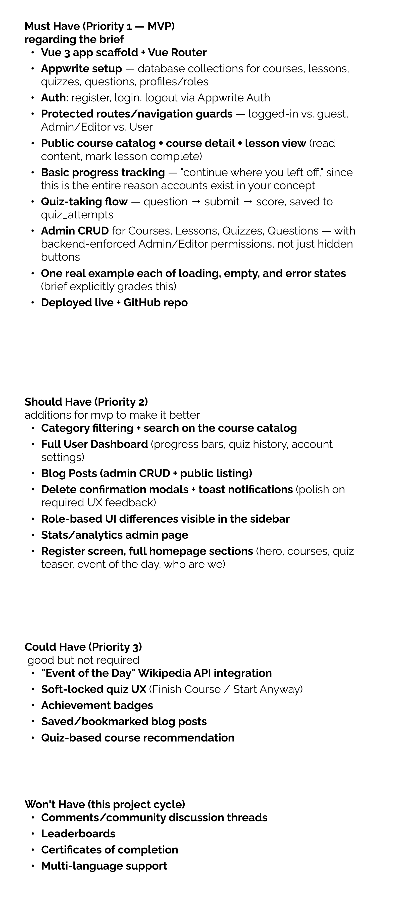
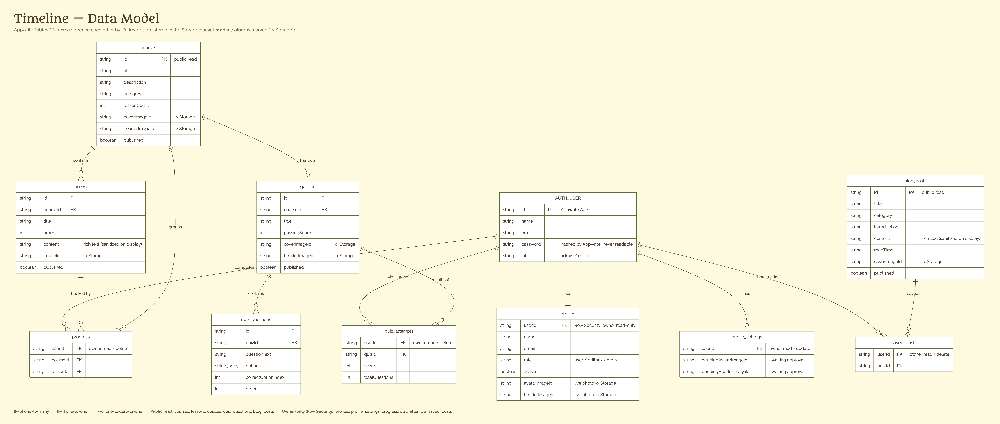
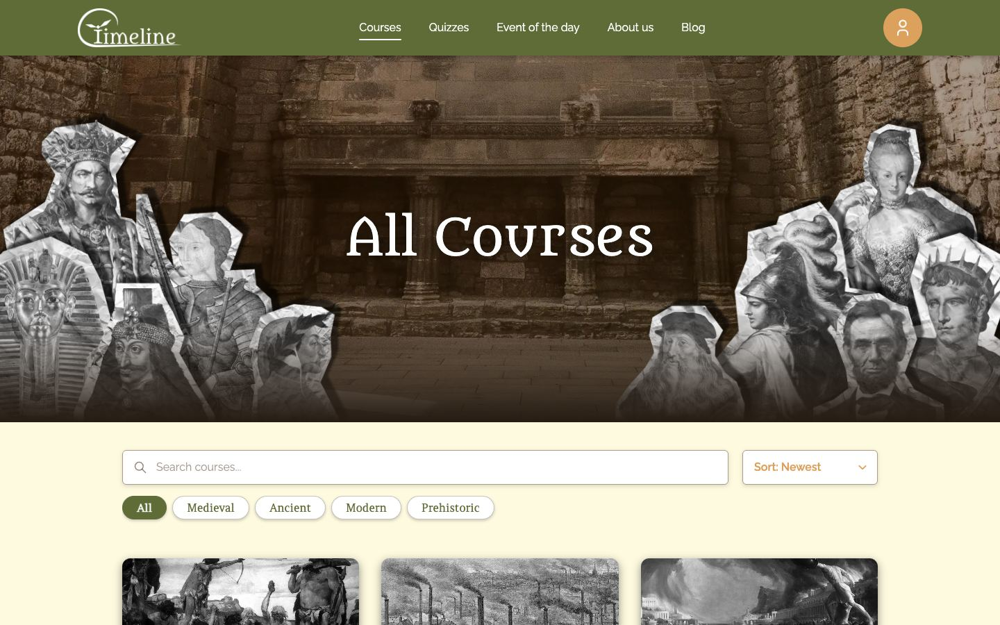
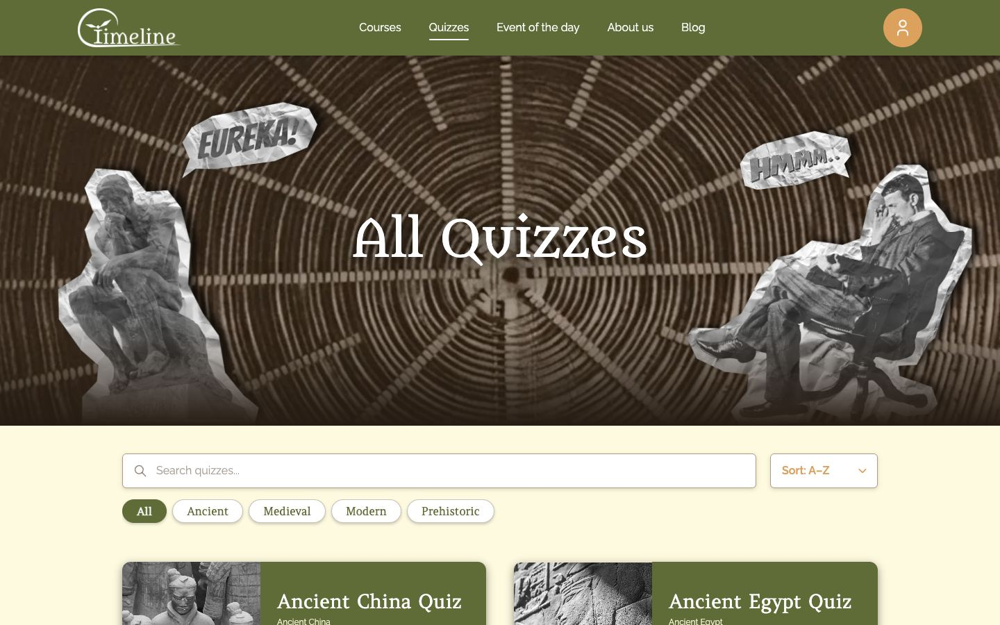
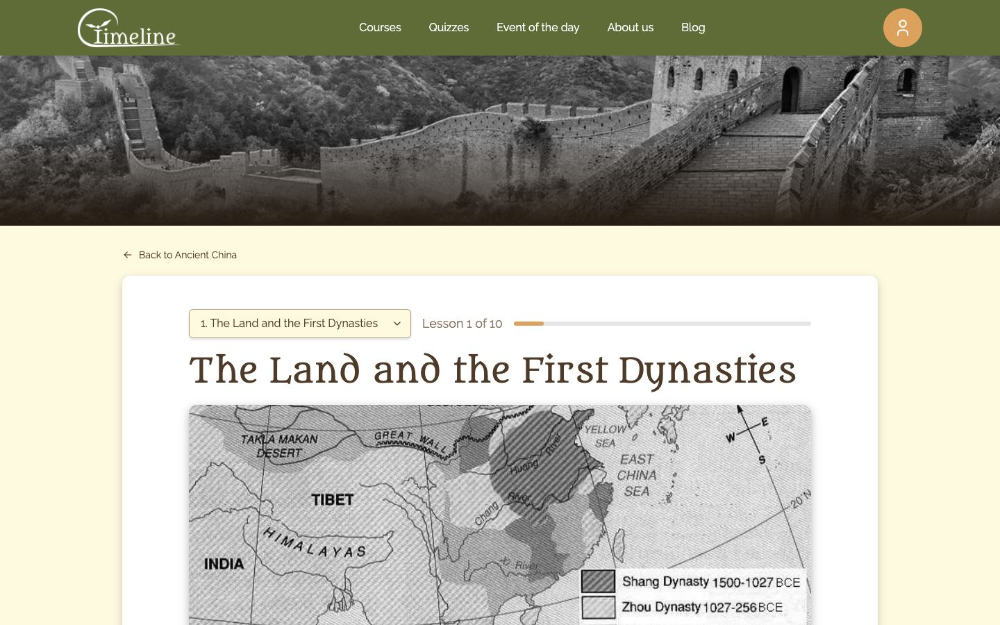
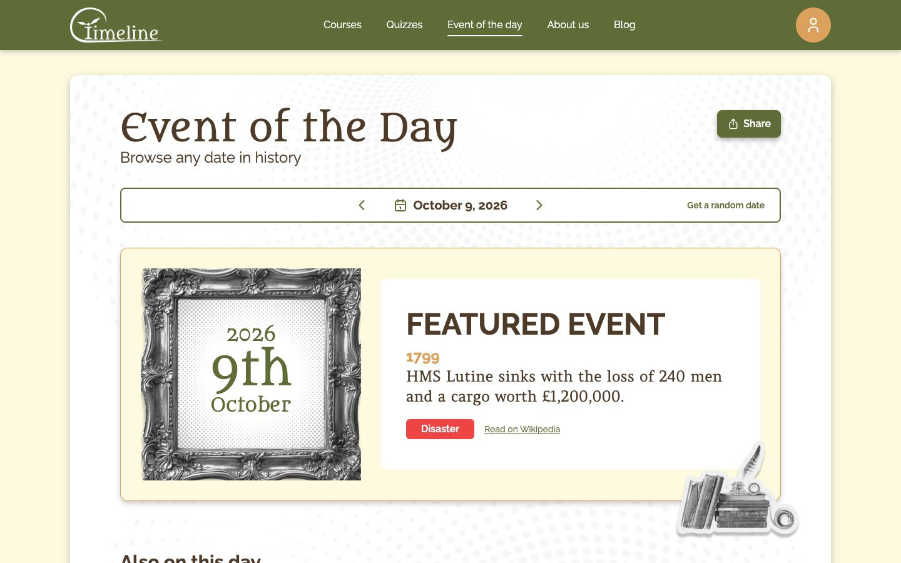
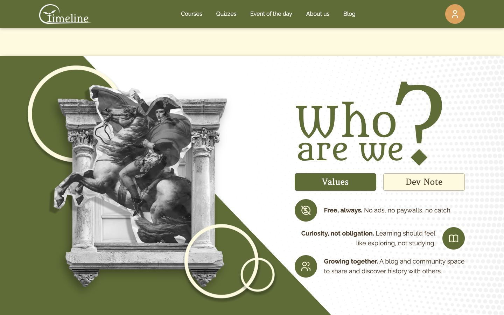

# Timeline

**A free website for learning history.** It has courses with lessons, quizzes to test yourself, a history blog, and a daily "on this day in history" event.

- **Website:** https://timeline.appwrite.network/
- **Code:** https://github.com/Mihaela1909/TimelineAppProject



---

## Contents

1. [Planning](#planning)
2. [What you can do on the site](#what-you-can-do-on-the-site)
3. [Who can do what](#who-can-do-what)
4. [What it's built with](#what-its-built-with)
5. [Running it on your own computer](#running-it-on-your-own-computer)
6. [How the data is stored](#how-the-data-is-stored)
7. [How the code is organised](#how-the-code-is-organised)
8. [Security](#security)
9. [Ease of use and accessibility](#ease-of-use-and-accessibility)
10. [Known limitations](#known-limitations)
11. [How AI was used](#how-ai-was-used)
12. [Screenshots](#screenshots)

---

## Planning

Before building anything, I planned the site in four steps:
1. a **persona**: an imagined typical user, to design for
2. a **MoSCoW list**: what the site *Must*, *Should*, *Could* and *Won't* have
3. a **data model**: how the information is stored
4. **Figma designs** for every page, which the finished pages follow

### Persona



How the site answers Mia's needs:

| What Mia needs or dislikes | How Timeline handles it |
|---|---|
| Hates having to sign up before seeing anything | Everyone can read every course and lesson, and take quizzes, without an account. An account is only needed to *save* progress or posts. |
| Embarrassed about getting answers wrong | Answers are checked instantly and privately, and quizzes can be retaken. Saved results are visible only to her. |
| Tired and easily distracted, needs content that's quick to scan | Short lessons, a "Lesson 3 of 8" progress bar, a menu to jump between lessons, clear headings and pictures |
| Needs a reason to come back | Her progress is saved, with a "Continue · Lesson 4" button, and her profile shows what she's working on |
| Doesn't trust "free" apps | Nothing is ever paid ("Free, always" on the home page) |
| Trusts what friends recommend | Share buttons, and nice previews when a link is shared in a chat |

### MoSCoW



**What happened to the plan**
- **Must have:** everything was built.
- **Should have:** everything was built.
- **Could have:** most were built: Event of the Day, the quiz "lock" until a course is finished, saving blog posts, and the level-check quiz that recommends a course. Only achievement badges were left out.
- **Won't have:** as planned. A few more things were left out on purpose because they need a separate server program (see [Known limitations](#known-limitations)).
- **Added along the way:** profile photos checked by an admin, user management, a statistics page, a "page not found" page, plus work on accessibility, search engines and speed.

### How the data fits together

See the data model diagram under [How the data is stored](#data-model).

---

## What you can do on the site

**Everyone (no account needed)**
- **Courses:** search them, filter by topic, sort them, and page through them. Each course has an overview page and lessons with text and pictures.
- **Quizzes:** one per course, with multiple-choice questions, instant feedback and a results screen.
- **Blog:** history articles by topic, with reading time, share buttons, and suggestions for what to read next.
- **Level check:** a quick quiz with 2 random questions from every course. It tells you your history level (Beginner, Explorer or Historian), shows how you did per course, and recommends the course you'd learn the most from. Nothing is saved.
- **Event of the Day:** a real historical event for any date, taken from Wikipedia. You can go to the previous or next day, pick a date, or get a random one. The date is in the web address, so you can share it.
- **Home page:** animated, with popular courses, a quiz teaser, today's event, an "About us" section and the latest blog posts.

**With a free account**
- **Course progress:** mark lessons as done (or undo), see "In progress" and "Completed" labels, and continue where you left off.
- **Quiz results** are saved, and each quiz shows Passed, Failed or Not attempted.
- **Saved posts:** keep blog posts to read later.
- **Profile page:** statistics (courses started and finished, quizzes taken, average score), course progress, quiz history, saved posts, and settings (name, email, password).
- **Profile picture and banner photo.** Every new photo, or removal, is **checked by an admin** before it appears on the site.

**Staff only (admin panel)**
- An overview page with totals and recent activity.
- Create, edit, publish and delete **courses, lessons, quizzes, quiz questions** and **blog posts**, with pictures. Quiz questions can be reordered by dragging, or with the arrow keys.
- **Admins only:** manage users (change their role, switch accounts off or on), approve or reject profile photos, and see statistics (which courses people take, how they do in quizzes, how many users there are).

---

## Who can do what

There are four kinds of visitors:

| | Visitor | User | Editor | Admin |
|---|:-:|:-:|:-:|:-:|
| Read courses, lessons, quizzes, blog, Event of the Day | ✅ | ✅ | ✅ | ✅ |
| Take quizzes | ✅ (not saved) | ✅ | ✅ | ✅ |
| Save progress, quiz results and posts; own profile | asked to log in | ✅ | ✅ | ✅ |
| Change own photos (an admin checks them first) | — | ✅ | ✅ | ✅ |
| Admin panel: courses, lessons, quizzes, blog | — | — | ✅ | ✅ |
| Users, roles, statistics, photo approvals | — | — | — | ✅ |

The site hides pages that you're not allowed to use, but that's only for convenience. **The real protection is on the database itself** (see [Security](#security)).

---

## What it's built with

| | |
|---|---|
| The website | **Vue 3** (a popular tool for building interactive websites) with **Vue Router** (moves between pages) and **Vite** (prepares the files for the web) |
| Design | **Tailwind CSS** (styling), with the brand colours defined in one place (`src/style.css`) |
| Database, logins and file storage | **Appwrite Cloud**: an online service that stores the data, handles accounts and passwords, and keeps the uploaded pictures |
| Hosting | **Appwrite Sites** (puts the website online) |
| Text editor in the admin panel | TipTap |
| Outside data | Wikipedia's free "On this day" service |

I didn't write any server code; all the server work is done by Appwrite. No extra design, icon or chart libraries are used: icons and charts are drawn with plain code.

---

## Running it on your own computer

You need Node.js (version 20.19 or newer) and a `.env` file containing the Appwrite connection details (the `VITE_APPWRITE_…` names that `src/services/appwrite.js` reads).

```bash
npm install     # download the tools the project needs
npm run dev     # start it at http://localhost:5173
npm run build   # make the final version for the web (in the dist/ folder)
```

The live site is published from this code with Appwrite Sites.

---

## How the data is stored

### Roles
Staff accounts get a **label** in Appwrite, either `admin` (can do everything) or `editor` (can only manage content). The database checks these labels before allowing any change, and the site reads the **same labels** to decide which pages to show. So the site and the database always agree on who is staff. The role saved in each profile is only a record shown on the admin Users page.

### Data model



### Tables

The information is stored in **tables**, a bit like spreadsheets. Each row is one item (one course, one lesson…), and rows point to each other by ID; for example, every lesson stores the ID of its course.

Some tables use **row security**: each row has its own lock, so only the person it belongs to (and admins) can see it.

| Table | What's in it | Row security | Who may read or change it |
|---|---|---|---|
| `profiles` | name, email, role, account on/off, photos | on | each user can read their own; only admins can change it |
| `profile_settings` | photos waiting for admin approval | on | each user manages their own; admins can see all |
| `courses` | title, description, topic, pictures, published or not | — | everyone can read; editors and admins can change |
| `lessons` | which course, title, order, text, picture | — | everyone can read; editors and admins can change |
| `quizzes` | which course, title, pass mark, pictures | — | everyone can read; editors and admins can change |
| `quiz_questions` | which quiz, question, answers, correct answer, order | — | everyone can read; editors and admins can change |
| `blog_posts` | title, topic, intro, text, reading time, picture | — | everyone can read; editors and admins can change |
| `progress` | which user finished which lesson | on | only that user (read or delete) and admins |
| `quiz_attempts` | a user's quiz score | on | only that user (read or delete) and admins |
| `saved_posts` | which user saved which post | on | only that user |

**Pictures** are kept in one storage folder: anyone can view them, and only logged-in users can upload. Pictures are made smaller in the browser before they're uploaded.

---

## How the code is organised

The detailed coding rules are in **[AGENTS.md](AGENTS.md)**, and the decisions made along the way are in **[CLAUDE.md](CLAUDE.md)**.

The code is split into layers, each with one job, and information always flows the same way:

**page → logic → database code → Appwrite**

```
src/
├── views/         One file per page.
├── components/    Reusable building blocks (cards, buttons, menus…), grouped by area.
├── composables/   The logic: what's loading, what went wrong, what to show.
├── services/      The only code that talks to the database, one file per table.
│                  appwrite.js is the only file that connects to Appwrite.
├── layouts/       The page frames: header + footer for visitors, sidebar for staff.
├── router/        The list of pages, and the check for who may open which page.
├── constants/     Fixed values, like the role names.
└── utils/         Small helpers, like date formatting.
```

**Example: pressing "Save" on a blog post**
1. The **page** (`BlogPostDetailView`) passes the click to
2. the **logic** (`useSavedPosts`), which ignores double-clicks and updates what's shown, and asks
3. the **database code** (`savedPostService`) to save it, after checking it isn't already saved. The saved row can only be seen by that user.

**Habits used throughout**
- **Every action is careful:** it ignores double-clicks, checks the input, clears old error messages, always switches the "busy" state off afterwards (even when something fails), and shows a short message saying whether it worked.
- **Calculations are kept separate** from loading data, so they're easy to understand and test, e.g. the statistics page (`buildStatistics()`).
- **Long lists are loaded completely:** Appwrite only sends 25 rows at a time, so the code keeps asking until it has everything (`listAllRows()`).
- **Deleting is done in a safe order:** deleting a course first deletes its lessons, quizzes and everyone's progress in it, and only then the course. If something fails halfway, the course is still there to try again.

---

## Security

**Hiding buttons and pages is not real security,** because anyone can send requests to the database directly. So every rule is also set on the database itself (in Appwrite), and requests that break a rule are refused.

- **Course, lesson, quiz and blog content:** everyone can read it, but only staff can change it.
- **Nobody can make themselves admin:** your role is stored in your profile, and you can read your profile but not change it.
- **The photo check can't be skipped:** the photo people see is in a table only admins can change. Users can only *suggest* a new photo, which is stored in a separate table.
- **Personal data stays personal:** progress, quiz scores and saved posts can only be seen by their owner. Scores can't be edited after the quiz, only deleted.
- **Harmful code in articles is blocked:** lesson and blog text is cleaned before it's shown, so even if someone sneaked a script into the database, it wouldn't run in visitors' browsers (`utils/sanitizeHtml.js`).
- **Other websites can't use the database from a visitor's browser:** browsers only send requests that Appwrite accepts from this site. (Tools outside a browser can still read what is public, which is why the real protection is the permissions above.) Appwrite also slows down repeated wrong passwords: after 10 tries, logging in is blocked for a while.
- **No passwords or secret keys are in the code.** The connection details in the `.env` file are not secret (every website needs them to talk to its database), and that file isn't uploaded to GitHub anyway.

---

## Ease of use and accessibility

- **Every page that loads information shows what's happening:** a grey placeholder while loading, a friendly message when there's nothing to show, and a clear error with a **Retry** button if something goes wrong.
- **Every action gets feedback:** a short pop-up message, a "Are you sure?" question before deleting, and buttons that switch off while saving.
- **Forms explain mistakes** in plain words: missing fields, too-short text, missing pictures.
- **Works on phones** as well as computers; on phones, the staff menu slides in from the side.
- **Accessibility** (for people using a keyboard, a screen reader, or other aids):
  - a "Skip to main content" link
  - every form field has a label, and every icon button has a spoken name (e.g. "Edit Ancient China")
  - every image has a description, or is marked as decoration
  - pop-up messages and errors are read out by screen readers
  - the "Are you sure?" box works fully with the keyboard
  - a visible outline shows where you are when using the keyboard, and quiz questions can be reordered with the arrow keys
  - colours were chosen to be readable
  - animations switch off for people who have asked their device for less motion

### Search engines
- Every page has its own title and description, plus a preview picture for when a link is shared.
- Private pages (login, profile, admin) are hidden from search engines.
- A list of all the site's pages (`sitemap.xml`) is made automatically every time the site is published, so search engines can find every course, lesson, quiz and post.

---

## Known limitations

These would need a separate server program (an Appwrite Function), which is beyond this website-only project:

- **Giving someone a staff role** is done by adding the Appwrite label by hand in the console. The role on the admin Users page is only a record; the site and the database both go by the label.
- **Quiz answers are checked in the browser.** The correct answers are stored with the questions, which anyone can read, so a skilled user could look them up or fake a score by talking to the database directly.
- **Drafts are "unlisted", not secret.** The site hides unpublished courses, lessons, quizzes and posts from visitors (staff can preview them), but the content tables are readable by anyone, so a draft can still be read through the database directly.
- **A photo waiting for approval** is hidden on the site, but its file can be opened by anyone who has its exact link.
- **Switching off an account is checked by the site, not the database:** the person is signed out the next time they open the site, but could still send requests to the database directly. Blocking them fully is done in the Appwrite console (Auth → the user → Block).
- **A user could create extra rows in `profiles`** through the database directly, because `userId` is a long text column and can't have a unique index. The site always uses the oldest row (the one made at registration), and roles come from Appwrite labels, so extra rows can't change anyone's access or photo. The proper fix would be a short `userId` column with a unique index, or using the user's ID as the profile row's own ID.
- **"Delete account" only signs you out;** fully deleting an account needs server code.
- **Rejected or replaced photos are not deleted** from storage.
- **The statistics are calculated in the browser** by loading all the data, which is fine for a site this size.
- **"Most popular courses"** shows the first published courses, because visitors' progress is private, so there's no popularity data.

---

## How AI was used

### Tool
**Claude Code** (made by Anthropic, using the Claude Opus model), inside VS Code. It can read the project, test it and edit files. I reviewed and tested every change before saving it. To keep it working my way, it follows two files I wrote:
- [AGENTS.md](AGENTS.md): how the code must be organised, and the design rules
- [CLAUDE.md](CLAUDE.md): the decisions made for this project, and why

### What I used it for
- **Building:** turning my Figma designs into working pages, and connecting the site to Appwrite.
- **Fixing problems:** e.g. "not allowed" errors from the database, pictures not loading, a page that crashed.
- **Checking:** security, accessibility, speed, search engines, and a final clean-up of unnecessary or repeated code.
- **Documentation:** this README and the data model diagram.

The planning was my own: the persona, the MoSCoW list and the Figma designs.

### Where AI helped
- **It found a data leak.** It tested the database the way a stranger would, and found that anyone could read every user's name, email and role, which the site itself never showed. I fixed the permissions, and a new test found nothing.
- **It blocked harmful code.** It noticed that lesson and blog text was shown without being cleaned first, and added a filter. None of the 10 attack examples we tested got through.
- **It made the site faster.** Google's speed test scored the home page 77/100. The page was waiting for the login check and the fonts before showing anything, and the pictures were too big. After the fixes it scored 98 when tested on my computer.

### Where I had to correct it
- **A security hole.** Its code let users change their own quiz scores. I spotted this while checking the project requirements, and it was removed; users can now only see and delete their own scores (`quizAttemptService.js`).
- **An approach that didn't work.** Its first way of protecting uploaded photos kept breaking the pictures. I chose a simpler setup instead, where an admin approves photos before they appear.
- **A paid feature.** It used an Appwrite feature for resizing pictures that only works on the paid plan, so it was replaced with one that works on the free plan.
- **Design details.** It follows instructions very literally, so I compared every page with my designs and corrected things: white cards instead of cream, no colour change on hover, thinner lines, smaller headings, and design changes that don't touch how things work.
- **Too much complexity.** Its first version of the faster login check was hard to follow. In the final clean-up I asked for code an average person can read, and it became a few simple lines that do the same thing.

### Reflection
AI made the work much faster. It was good at repetitive tasks, at explaining errors, and at checking things I wouldn't have thought of. But my own judgement was still essential:
- **Security:** its code had a security hole, and the data leak only showed up when we actually tested it. Hidden buttons *look* safe, so I always checked the database permissions myself.
- **Design:** making the pages match my designs needed my eye, page by page.
- **Clean, readable code:** without my rules it tended to mix things together or make them complicated. I decided what was simple enough.
- **Scope:** AI will happily keep adding features; my MoSCoW list decided what got built.

---

## Screenshots

| | |
|---|---|
|  |  |
|  |  |
|  |  |


